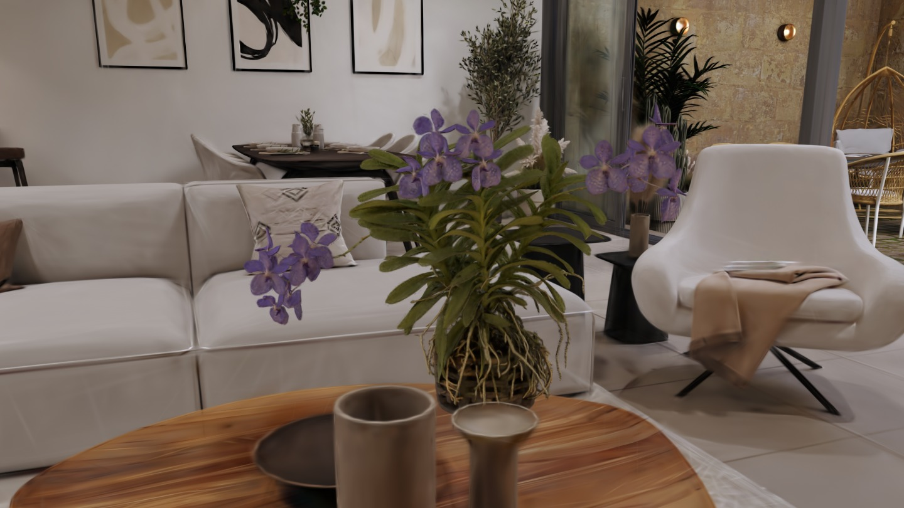
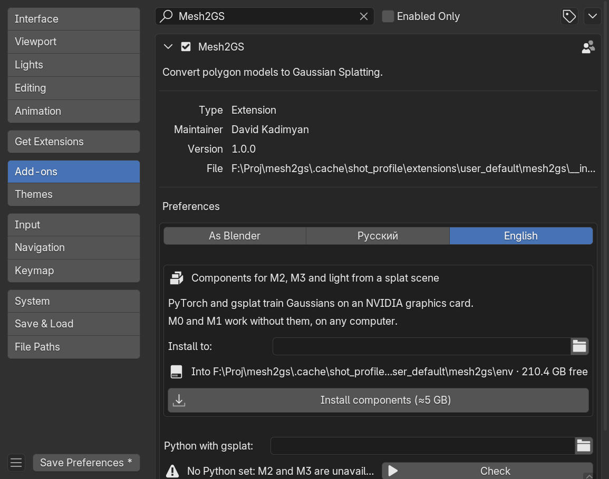
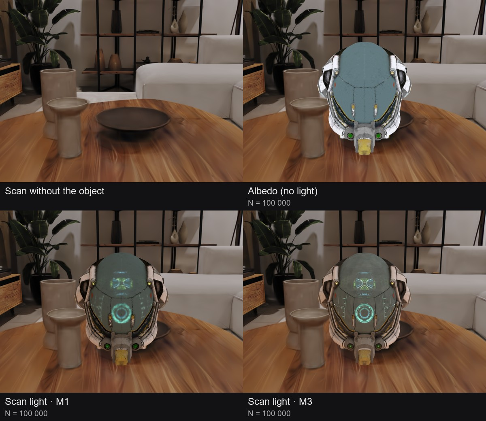

# Mesh2GS

A Blender add-on that converts polygon models into Gaussian Splatting (3DGS) and saves the result as
an original-3DGS PLY or a compressed SPZ. It works directly on the Blender scene: modifiers,
textures, procedural materials and, optionally, baked lighting are taken into account. The result can
be placed into captured splat scenes and opened in splat viewers and game engines.



## Features

| Method | How it works | Requirements | Time for 100k Gaussians |
|---|---|---|---|
| **M1**, analytic | points spread evenly over the surface area, flat discs that do not overhang sharp edges, colour sampled from the texture at every point | any computer | about a second (baking light or procedural materials adds 5–15 s) |
| **M3**, hybrid | starts from M1 and runs a short training (1000 iterations) on renders of the model | NVIDIA GPU (CUDA), Python with gsplat | about 30 s |
| **M2**, optimization | 3DGS training from random points (7000 iterations) | NVIDIA GPU (CUDA), Python with gsplat | about a minute |
| **M0**, KIRI scheme | a fixed number of Gaussians per triangle, like Mesh 2 3DGS in KIRI 3DGS Render; for comparison | any computer | a fraction of a second |

- The budget is set as a number of Gaussians or as a density per square metre; the file size is shown
  before converting.
- Colour: **Albedo** (material colour and emission) or **Scene light** (lighting baked with Cycles).
  Procedural materials are baked automatically.
- Light from a splat scene: a panorama of a captured scene, taken where the object stands, becomes the
  World, so the object is lit by the scene itself.
- PLY export with a choice of axes (RDF for SuperSplat and PlayCanvas, RUF for Unity, RUB, Blender
  axes) and SPZ version 3: 4–20 times smaller, with an export scale and a warning about model size.
- PLY and SPZ import with a viewport preview, and a switch between the source and the Gaussians.
- M2/M3 training runs in a separate process: progress in the panel, Blender stays responsive, the
  training can be cancelled.
- English and Russian interface; the language is chosen in the add-on preferences.
- Blender 4.2 and newer (Extension package) and Blender 3.6 (legacy add-on).

## Installation

**Blender 4.2 and newer.** Build the package:

```
blender -b --command extension build --source-dir mesh2gs --output-dir dist
```

Then Edit → Preferences → Get Extensions → ▾ → Install from Disk → `dist/mesh2gs-1.0.0.zip`.

**Blender 3.6.** Copy the `mesh2gs/` folder into
`%APPDATA%\Blender Foundation\Blender\3.6\scripts\addons\` and enable the add-on in
Preferences → Add-ons.

**M2, M3 and light from a splat scene** need an NVIDIA graphics card and two libraries: PyTorch and
gsplat (Gaussian rendering and training on CUDA). They are not bundled with the add-on: together they
take about 5 GB, and prebuilt gsplat packages exist only for Python 3.10, while Blender ships a newer
Python. The add-on preferences (Preferences → Add-ons → Mesh2GS) therefore have an
**Install components (≈5 GB)** button: it downloads its own Python 3.10, PyTorch and gsplat into the chosen
folder, checks the graphics card and sets the path. No system Python or administrator rights are
needed, and Blender stays usable during the installation. Choose a folder on a drive with 9 GB free;
temporary files and the pip cache stay inside it. The button also appears in the add-on panel when M2
or M3 is selected and the components are missing. To set up the environment yourself, use the
**Install by hand** section in the preferences, which lists the commands.



M0 and M1 work without these components, on any OS and graphics card.

## Usage

1. Select mesh objects. In Edit Mode only the selected faces can be converted.
2. Sidebar (N) → **Mesh2GS** tab, or the Object menu / right-click menu → *Mesh2GS: to Gaussians…*.
3. Choose the method, colour mode and budget.
4. Click **Convert**. An object `<name>.<method>` appears in the *Gaussians* collection, and the
   sources are hidden.
5. In the **Result** subpanel, use **Export PLY…** or **Export SPZ…**.

The preview colours are visible in Material Preview, and in Solid mode with the *Attribute* colour.

### Light from a splat scene

1. Import the captured scene: File → Import → *Gaussian Splatting (.ply, Mesh2GS)* or *(.spz, Mesh2GS)*.
2. Place the model in the scene and select it.
3. Colour mode **Scene light** → choose the splat scene → **Light from splat scene**. The add-on renders
   a 360° panorama from the centre of the model and sets it as the World.
4. Click **Convert**: the scene light is baked into the colours of the Gaussians.

The panorama stores colours in a standard (LDR) range, so windows and lamps are no brighter than a
white wall and the light comes out weaker than in reality. Raising the World strength (about ×3 for
the scan below) brings the object to the brightness of the room.



### Using the result in Unity

Export a PLY with the **RUF** axes and import it with
[UnityGaussianSplatting](https://github.com/aras-p/UnityGaussianSplatting) (Tools → Gaussian Splats →
Create GaussianSplatAsset), then add a GaussianSplatRenderer to an object. The plugin needs
Direct3D 12 or Vulkan and a project in the Linear colour space. It sorts Gaussians within one asset
and draws separate assets as wholes, so for an object that stands inside a captured scene, append its
Gaussians to the scene's PLY (both in the same axes) and import the combined file.

## Limitations

- Colour does not depend on the viewing direction (spherical harmonics of degree 0): highlights and
  reflections are not kept. In Scene light mode, metal is baked as a matte surface of the same colour.
- Light is baked into the colours: Gaussians have no dynamic lighting, and the object has to be
  converted again after the light changes.
- Light from a splat scene comes from far away: there are no contact shadows.
- M2 and M3 train on cameras around the object, so they are meant for objects, not interiors.
- M2, M3 and light from a splat scene require an NVIDIA graphics card.
- Tested on Windows in Blender 4.4 and 3.6. The code should work on Linux but has not been tested.
- In Blender 3.6, the Russian interface of the add-on in an English Blender requires
  Preferences → Interface → Translation → Interface.

## Development

### Structure

```
mesh2gs/                 # add-on sources (root of the Extension package)
  blender_manifest.toml
  __init__.py            # registration + bl_info for Blender 3.6
  props.py ui.py operators.py   # settings, panel and dialog, operators
  i18n.py                # Russian translation of the interface (code is in English)
  preview.py             # object with Gaussians and Geometry Nodes preview
  extract.py             # evaluated mesh → NumPy, world coordinates
  materials.py           # where the colour comes from: constant, image texture by UV, or baking
  bake.py                # baking colour and light on a temporary copy (Cycles)
  views.py               # training views for M2/M3 in a temporary scene (Cycles)
  training.py            # M2/M3 job and panorama: external Python, progress, cancel
  setup_env.py           # Install components: Python 3.10, PyTorch and gsplat into a folder
  train.py               # training with gsplat (outside Blender; trainer/train.py is the old path)
  panorama.py            # 360° panorama of a splat scene with gsplat (outside Blender)
  core/                  # no bpy: also used outside Blender
    gaussians.py         # common Gaussian set
    analytic.py          # M1
    baseline.py          # M0 (KIRI scheme)
    color.py             # linear ↔ sRGB
    texture.py           # image sampling, colour field over triangles
    axes.py              # axis presets (RDF, RUF, RUB, RFU)
  io/ply.py              # reading and writing 3DGS PLY
  io/spz.py              # reading and writing SPZ (versions 2 and 3)
tests/                   # unittest: core and operators on a real scene
docs/images/             # README images
```

### Tests

```
python tests/run_tests.py
blender -b --factory-startup --python-exit-code 1 --python tests/run_tests.py
```

Without Blender the operator tests are skipped and the core tests run. The M2/M3 training and
splat-scene light tests run when a Python with PyTorch, gsplat and CUDA is found, and are skipped
otherwise.

## Credits

- Apartment scan «SA3D_R&D_XP47» by Stephane Agullo (https://sa3d.fr), CC-BY 4.0, from the
  [PlayCanvas engine examples](https://github.com/playcanvas/engine/tree/main/examples/assets/splats).
- *Vanda coerulea* scan: Smithsonian Gardens, [Smithsonian 3D](https://3d.si.edu), CC0.
- DamagedHelmet: theblueturtle_ (CC-BY-NC 4.0) and ctxwing (CC-BY 4.0), from
  [glTF Sample Assets](https://github.com/KhronosGroup/glTF-Sample-Assets).
